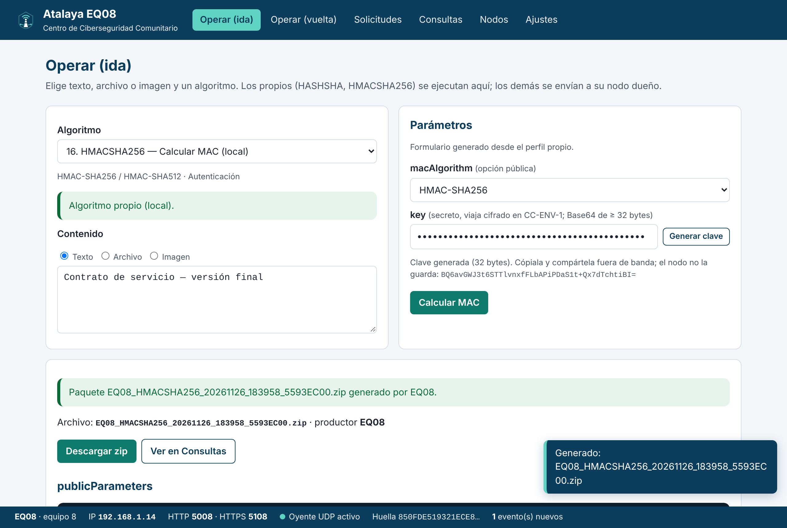
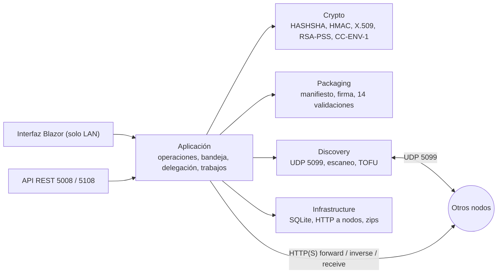

# Atalaya EQ08 — Nodo del Centro de Ciberseguridad Comunitario

<p align="center"></p>

**Versión 1.1.0** · Nodo **`EQ08`** (Equipo 8) del **Centro de Ciberseguridad Comunitario**, proyecto de la materia *Virología y Criptografía* (UPIICSA, 2027-1). Cada equipo opera un nodo. Los nodos se encuentran solos en la red local, se piden entre sí la ejecución de algoritmos criptográficos e intercambian paquetes `.zip` firmados, según el [Estándar de Comunicación v2.0](docs/estandar/Estandar_Comunicacion_v2.0.md).

«Atalaya» es el nombre que proponemos para el producto. Está pendiente de aprobación del equipo; ver el [Manual de identidad](docs/manuales/Manual_Identidad.md).



## Qué hace

| Rol (§2) | En EQ08 |
| --- | --- |
| **Proveedor** | Ejecuta sus algoritmos para cualquier nodo: `POST /api/crypto/forward` e `inverse`, con trabajos asíncronos |
| **Solicitante** | Desde la interfaz opera con los 21 algoritmos. Los ajenos los delega al equipo dueño, con la petición firmada y los secretos cifrados |
| **Emisor** | Arma paquetes `.zip` v2.0 firmados (RSA-PSS) y los envía, re-firmados, a la bandeja de otro nodo |
| **Receptor** | Valida cada paquete con las 14 reglas de §13.1 y lo muestra en *Solicitudes* para Aceptar o Rechazar |

### Algoritmos

| Algoritmos | Dónde se ejecutan |
| --- | --- |
| **15 `HASHSHA`** (SHA-256, SHA-512) y **16 `HMACSHA256`** (HMAC-SHA256) | **Locales**: los implementa EQ08 |
| 1–2 `AESGCM`, `DES` (EQ01) · 3–4 `TRIPLEDES`, `CHACHA20` (EQ02) · 5–6 `RSA`, `ECC` (EQ03) · 7–8 `DIFFIEHELLMAN`, `CAESAR` (EQ04) · 9–10 `VIGENERE`, `XORASM` (EQ05) · 11–12 `LSBSTEGO`, `EUCLIDESAFFINE` (EQ06) · 13–14 `MILLERRABIN`, `FISHERYATES` (EQ07) | **Delegados** al nodo dueño |
| 17–21 `DIGITALSIG`, `QUANTUMPQC`, `DFTSPECTRAL`, `LAGRANGESHAMIR`, `LORENZSZ40` | Reservados: se usan si algún nodo los anuncia (gana el `teamNumber` menor) |

### Arquitectura en una imagen



Hay más detalle en el [Manual técnico](docs/manuales/Manual_Tecnico.md).

## Releases

Cada versión se publica como [GitHub Release](https://github.com/yaelrdf/Proyecto_Virologia_y_Criptografia_UPIICSA/releases) con dos descargas autocontenidas, que no necesitan .NET instalado, y su `SHA256SUMS.txt`:

- **Windows**: `centrociber-eq08-win-x64-vX.Y.Z.zip`. Descomprime y ejecuta `Iniciar-Atalaya.cmd`.
- **Linux**: `Atalaya-EQ08-vX.Y.Z-x86_64.AppImage`. Dale permiso con `chmod +x` y ejecútala.

La publicación la hace el workflow [`release.yml`](.github/workflows/release.yml), de una de dos formas:

- al subir un tag `vX.Y.Z`;
- a mano desde *Actions → Release → Run workflow*, eligiendo la rama y el tag; si el tag no existe, se crea.

| Versión | Rama | Novedades |
| --- | --- | --- |
| **1.1.0** | `release/v1.1-relay-compat` | Panel de pruebas (Enviar y Bandeja), diagnóstico de rechazos, tolerancia a manifiestos y resultados de otros equipos, y compatibilidad revisada con [RelayCryptoNode (EQ06)](docs/interoperabilidad/RelayCryptoNode.md) |
| 1.0.0 | `claude/blissful-thompson-nc8dgj` | Las 9 fases del plan |

## Requisitos

- **Windows 10/11 o Linux x64.** Con la publicación autocontenida (`win-x64`, `linux-x64`) no hace falta instalar .NET.
- Para desarrollar: **.NET SDK 10** y, para las pruebas de interoperabilidad, **Python 3.10+** con `cryptography` y `pytest`.
- Red local que permita broadcast UDP. Si no lo permite, se puede usar el escaneo o el alta manual.

## Inicio rápido

### Linux

```bash
git clone <este-repositorio> && cd Proyecto_Virologia_y_Criptografia_UPIICSA
export CC_PFX_PASSWORD='una-contraseña-larga'   # protege el certificado de identidad
dotnet run --project src/CentroCiber.Web
```

```bash
sudo scripts/firewall-linux.sh 8   # abre 5008/tcp, 5108/tcp y 5099/udp
```

### Windows (PowerShell)

```powershell
$env:CC_PFX_PASSWORD = "una-contraseña-larga"
dotnet run --project src\CentroCiber.Web
```

```powershell
.\scripts\firewall-windows.ps1 -Team 8   # como Administrador
```

Abre **http://localhost:5008**. Para probar con otros equipos usa **Enviar** (crear y mandar paquetes a su bandeja) y **Bandeja** (ver lo recibido con vista previa de texto o imagen, y descifrar). En el primer arranque se crean `data/identidad.pfx` (RSA-2048, `CN=EQ08`) y `data/centrociber.db` con 38 registros de semilla.

Para una demo con dos nodos en la misma máquina, usa `scripts/run-two-nodes.sh` o `scripts/run-two-nodes.ps1`. Para probar la delegación sin otros equipos: `dotnet run --project tools/CentroCiber.MockNode -- --port 5001`, que simula a EQ01 con AESGCM.

La instalación completa (publicación, firewall, HTTPS, confirmación de nodos y solución de problemas) está en el [Manual de instalación y configuración](docs/manuales/Manual_Instalacion_Configuracion.md).

## Puertos

| Servicio | Protocolo | Puerto |
| --- | --- | --- |
| API e interfaz | HTTP | **5008** (`5000 + 8`) |
| API e interfaz | HTTPS (mismo certificado de identidad) | **5108** (`5100 + 8`) |
| Anuncio de descubrimiento | UDP | **5099** (común a todos los nodos) |

## Variables de entorno

Toda la configuración de `appsettings.json` (sección `Node`) se puede cambiar con variables que empiezan con `CC_`; los niveles se separan con `__`.

| Variable | Por omisión | Descripción |
| --- | --- | --- |
| `CC_PFX_PASSWORD` | — (**obligatoria**) | Contraseña del PFX de identidad. Nunca va en `appsettings` |
| `CC_Node__TeamNumber` | `8` | Número de equipo; define `nodeId` y puertos |
| `CC_Node__HttpPort` / `CC_Node__HttpsPort` | `0` (= 5000+n / 5100+n) | Puertos |
| `CC_Node__HttpsEnabled` | `true` | Ofrecer HTTPS |
| `CC_Node__DataPath` | `data` | Carpeta de BD, PFX y paquetes |
| `CC_Node__AdvertisedIp` | detectada | IP anunciada y usada en `sourceIp` |
| `CC_Node__UiLanOnly` | `true` | Limitar la interfaz a IP privadas o de loopback |
| `CC_Node__SyncTimeoutSeconds` | `30` | Tope síncrono antes de responder `202` |
| `CC_Node__MaxConcurrentCryptoRequests` | `10` | Límite de `/api/crypto/*` simultáneas (`E-BUSY`) |
| `CC_Node__Discovery__Enabled` | `true` | Anuncio y oyente UDP |
| `CC_Node__Discovery__ListenPort` | `5099` | Puerto UDP |
| `CC_Node__Discovery__Targets__0` | vacío | Destinos explícitos `ip:puerto` (pruebas) |
| `CC_Node__Discovery__ScanPortFrom` / `...ScanPortTo` | `5001` / `5020` | Rango del escaneo |

## Desarrollo y pruebas

```bash
dotnet tool restore
dotnet build CentroCiber.slnx -warnaserror
dotnet test CentroCiber.slnx                 # incluye el puente de interoperabilidad con Python
python3 -m pytest tests/interop -q           # verificación independiente
python3 tests/interop/verify_package.py vectores/EQ08/HASHSHA_ejemplo.zip
```

La CI ([`.github/workflows/ci.yml`](.github/workflows/ci.yml)) compila y prueba en Ubuntu y Windows, y publica artefactos autocontenidos `win-x64` y `linux-x64`.

## Estructura del repositorio

```text
CentroCiber.slnx              Solución .NET 10
src/CentroCiber.Web           Host: Blazor, API REST, Kestrel, filtro solo-LAN
src/CentroCiber.Application   Casos de uso, proveedores local/remoto, bandeja, trabajos, directorio
src/CentroCiber.Crypto        Constantes del protocolo, HASHSHA, HMAC, identidad X.509, RSA-PSS, CC-ENV-1
src/CentroCiber.Packaging     Manifiesto v2.0, hash canónico, cadena de firma, zip, 14 validaciones, contratos
src/CentroCiber.Discovery     Anuncio/oyente UDP 5099, escaneo /24
src/CentroCiber.Infrastructure EF Core + SQLite, migraciones, semilla, HTTP con huella fijada, almacén de zips
tests/                        xUnit (Crypto, Packaging, Api, Web/bUnit) e interop/ en Python
tools/                        MockNode (EQ01 simulado) y VectorGen (vectores §16.1)
vectores/EQ08/                Vectores públicos de prueba (llave marcada PRUEBA)
scripts/                      Firewall, publicación, dos nodos, OpenAPI, configuración de la nube
docs/                         Estándar, plan, manuales, API, BD, backlog, ADR, interoperabilidad
```

## Documentación

| Documento | Contenido |
| --- | --- |
| [Estándar de Comunicación v2.0](docs/estandar/Estandar_Comunicacion_v2.0.md) | Norma común de los equipos |
| [Plan de implementación](docs/plan/Plan_Implementacion_EQ08.md) | Decisiones, fases y criterios |
| [Manual técnico](docs/manuales/Manual_Tecnico.md) | Arquitectura, flujos, datos, criptografía, extensión |
| [Manual de instalación y configuración](docs/manuales/Manual_Instalacion_Configuracion.md) | Windows y Linux paso a paso |
| [Manual de identidad](docs/manuales/Manual_Identidad.md) | Nombre, logotipo, paleta, tipografía, tono (propuesta) |
| [Reporte general](docs/manuales/Reporte_General.md) | Objetivos, resultados de pruebas, conformidad, lecciones |
| [Backlog](docs/backlog/Backlog.md) | Épicas, historias, estado y pendientes |
| [API](docs/api/README.md) · [OpenAPI](docs/api/openapi.json) | Endpoints con ejemplos `curl` |
| [Base de datos](docs/base-de-datos/README.md) | Diagrama ER, diccionario de datos, semilla |
| [Decisiones de arquitectura (ADR)](docs/arquitectura/decisiones/README.md) | Decisiones e interpretaciones del estándar |
| [Interoperabilidad](docs/interoperabilidad/README.md) · [Matriz](docs/interoperabilidad/Matriz.md) · [Conformidad §16.2](docs/interoperabilidad/Conformidad.md) · [RelayCryptoNode (EQ06)](docs/interoperabilidad/RelayCryptoNode.md) | Pruebas contra otros equipos |
| [Vectores EQ08](vectores/EQ08/README.md) | Vectores públicos §16.1 |
| [Contribuir](CONTRIBUTING.md) · [Código de conducta](CODE_OF_CONDUCT.md) · [Seguridad](SECURITY.md) · [Cambios](CHANGELOG.md) | Normas del repositorio |

## Equipo

<!-- TODO: integrantes — nombre, boleta y rol de cada integrante del Equipo 8 -->

| Integrante | Rol |
| --- | --- |
| <!-- TODO: integrantes --> | <!-- TODO --> |

Profesor(a): <!-- TODO: nombre del profesor(a) -->

## Licencia

Copyright © 2026 Equipo 8, UPIICSA.

Este programa es software libre: puedes redistribuirlo y modificarlo bajo los términos de la **Licencia Pública General de GNU versión 3** (GPL-3.0), publicada por la Free Software Foundation. Se distribuye con la esperanza de que sea útil, pero **sin ninguna garantía**, ni siquiera la garantía implícita de comerciabilidad o idoneidad para un propósito particular. Consulta el archivo [`LICENSE`](LICENSE) para más detalles.
