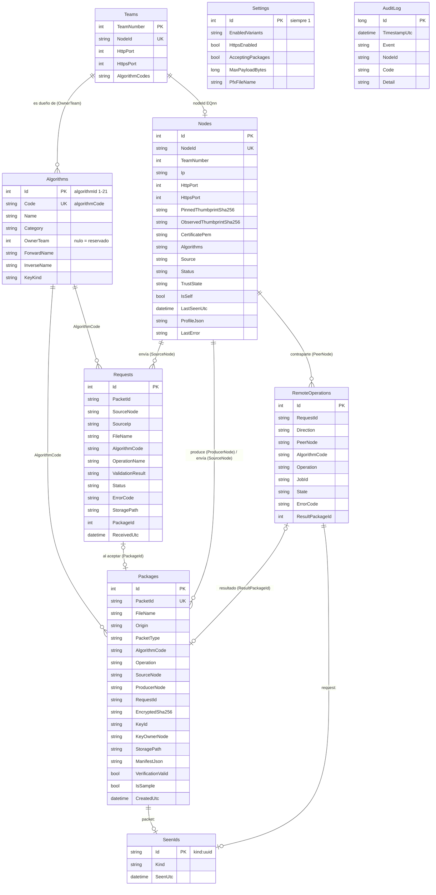

# Diagrama entidad-relación

Las relaciones son **lógicas**, por identificador del protocolo. No se declaran llaves foráneas en SQLite, porque los registros de otros nodos pueden llegar antes que el nodo al directorio, y porque los paquetes conservan su historial aunque el nodo se borre del directorio.

