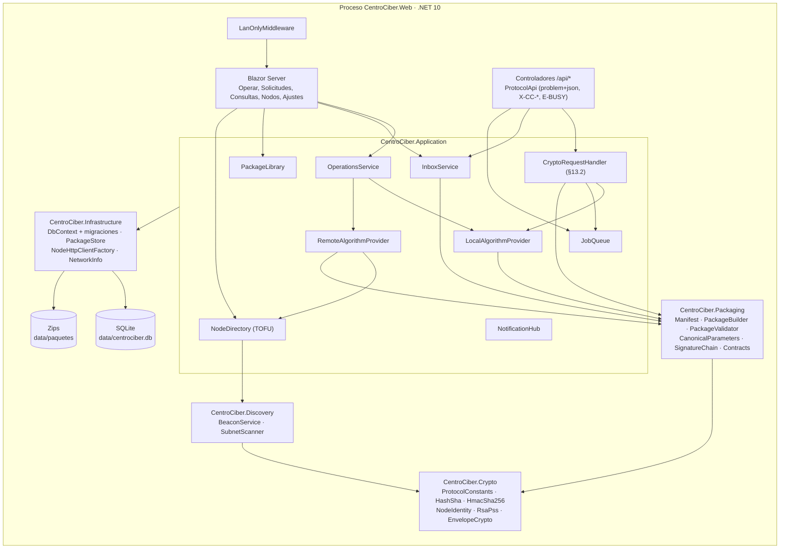
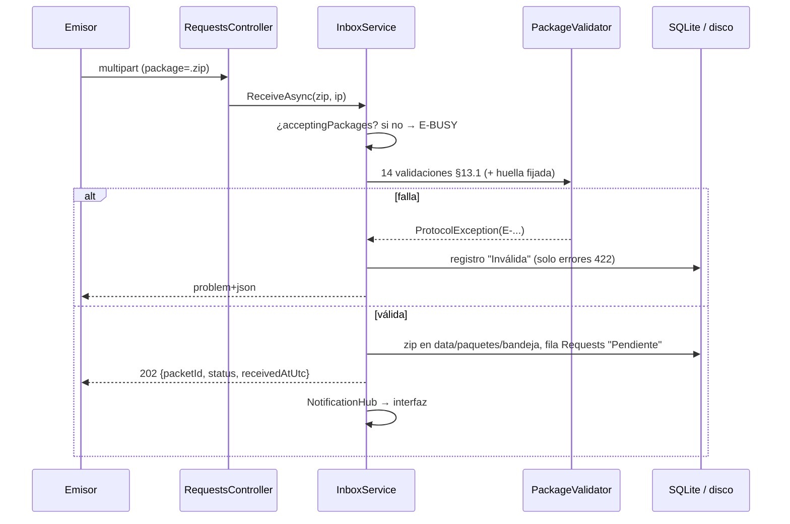
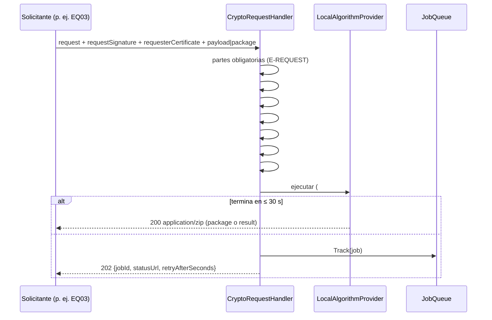
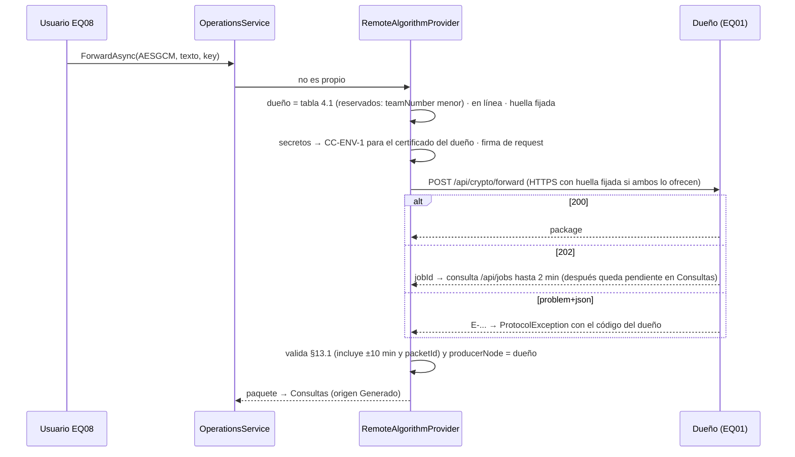

# Manual técnico — Nodo EQ08 (Atalaya)

| Campo | Valor |
| --- | --- |
| Versión del producto | 1.0.0 |
| Estándar implementado | [Estándar de Comunicación v2.0](../estandar/Estandar_Comunicacion_v2.0.md) |
| Plataforma | .NET 10 LTS, ASP.NET Core, Blazor Server, EF Core 10 + SQLite |
| Sistemas | Windows y Linux (`win-x64`, `linux-x64`) |

## 1. Visión general

EQ08 es **una sola aplicación ASP.NET Core** que hospeda:

- la **API REST** del estándar (HTTP 5008 y HTTPS 5108);
- la **interfaz web** Blazor Server (solo LAN);
- dos **servicios en segundo plano**: el anuncio y oyente UDP 5099, y el monitoreo de nodos (fuera de línea a los 90 s, purga de trabajos).

Todo algoritmo, propio o ajeno, se usa con el mismo contrato `forward` / `inverse` y siempre produce un paquete v2.0 con el mismo formato (§11.5).



## 2. Proyectos y dependencias

| Proyecto | Responsabilidad | Depende de |
| --- | --- | --- |
| `CentroCiber.Crypto` | Constantes del protocolo, identificadores (§3), catálogo de errores (Anexo B), diccionario 4.1, `HASHSHA`, `HMACSHA256`, identidad X.509/PFX, RSA-PSS, sobre `CC-ENV-1` | — (hoja) |
| `CentroCiber.Packaging` | Manifiesto v2.0, hash canónico (§8.5), cadena de firma (§8.4), constructor de `package`/`result`, `multipart`, reenvío, las 14 validaciones (§13.1), contratos JSON de la API y constructor de peticiones firmadas | Crypto |
| `CentroCiber.Discovery` | Anuncio y oyente UDP (§6.1), escaneo /24 (§6.2) | Crypto |
| `CentroCiber.Infrastructure` | EF Core + SQLite, migraciones y semilla, almacén de zips, clientes HTTP con huella fijada, utilidades de red | Crypto |
| `CentroCiber.Application` | Casos de uso: proveedor local/remoto, manejador de `/api/crypto/*`, bandeja, Consultas, directorio y TOFU, cola de trabajos, notificaciones | Crypto, Packaging, Discovery, Infrastructure |
| `CentroCiber.Web` | Host: Kestrel, controladores, middleware, Blazor, descargas | Application |
| `tools/CentroCiber.MockNode` | Nodo simulado EQ01 con AESGCM | Packaging |
| `tools/CentroCiber.VectorGen` | Generador de `vectores/EQ08/` | Packaging |

Los paquetes NuGet se administran de forma central (`Directory.Packages.props`): EF Core Sqlite 10.0.15, `Microsoft.AspNetCore.OpenApi` 10.0.15, xUnit 2.9.3, Shouldly 4.3, bUnit 2.15 y `Mvc.Testing` 10.0.15. **No** se usan librerías criptográficas externas: todo sale de `System.Security.Cryptography` ([ADR 0001](../arquitectura/decisiones/0001-dotnet-10.md)). La razón de esta distribución de constantes y contratos está en el [ADR 0010](../arquitectura/decisiones/0010-protocol-constants-location.md).

## 3. Arranque

`Program.cs` llama a `NodeHost.Build`, que:

1. Lee `appsettings.json` y las variables `CC_*` (`NodeOptions`).
2. Crea la carpeta de datos, **migra la BD** y lee los ajustes (HTTPS activo).
3. Lee `CC_PFX_PASSWORD`. Si falta, **no arranca** y explica por qué ([ADR 0004](../arquitectura/decisiones/0004-pfx-password-env.md)).
4. Carga o genera `identidad.pfx` (`NodeIdentity.LoadOrCreate`) y comprueba que el CN coincida con el `nodeId` configurado.
5. Configura Kestrel: `ListenAnyIP(5008)` y `ListenAnyIP(5108, UseHttps(certificado de identidad))`. El cuerpo máximo es de 50 MB.
6. Registra los servicios, el anuncio UDP y el monitoreo, y sincroniza la fila propia del directorio.

## 4. Flujo de cada endpoint

### 4.1 `GET /api/status`, `/api/certificate`, `/api/algorithms`, `/api/keys/{id}`

`NodeController`: estado (§10.3) con la huella actual y los algoritmos propios; el PEM de la identidad; los perfiles (§10.4) construidos por `AlgorithmProfiles` con las variantes habilitadas en Ajustes. `keys/{id}` siempre responde `404 E-KEY-NOT-FOUND`, porque EQ08 no tiene algoritmos con `keyId`.

### 4.2 `POST /api/requests/receive`



En la interfaz, **Aceptar** mueve el zip a Consultas (origen `Recibido`) y **Rechazar** lo borra.

### 4.3 `POST /api/crypto/forward` e `inverse`



En `inverse`, `resultado.enc` es el original cifrado con `CC-ENV-1` para el certificado del solicitante; el AAD es el `packetId` del `result`. El veredicto va en `verification` con `200` ([ADR 0008](../arquitectura/decisiones/0008-verify-failed.md)).

### 4.4 `GET /api/jobs/{id}` y `/result`

`JobQueue` (en memoria) guarda los trabajos; los terminados se conservan al menos 1 h. El resultado solo se entrega si `X-CC-Node` es el solicitante original; si no, responde `404 E-JOB-NOT-FOUND` ([ADR 0011](../arquitectura/decisiones/0011-job-result-access.md)).

### 4.5 Delegación (cliente)



**Reenviar a una bandeja ajena** (§11.3) usa `PackageForwarder`: genera un nuevo `packetId` y `timestampUtc`, pone `sourceNode = EQ08` con el certificado propio, vuelve a firmar y conserva `datos.enc`, `publicParameters`, `keyRef` y `producerNode`.

### 4.6 Descubrimiento

- `BeaconService` envía `CC-BEACON` al iniciar y cada 30 s a `255.255.255.255:5099` y al broadcast de cada interfaz, con la IP de la interfaz de salida. Al apagarse envía `offline`. El socket usa `ReuseAddress` y `EnableBroadcast`.
- `DiscoveryPeer.OnBeaconAsync` descarta los anuncios propios o de otra versión y llama a `NodeDirectory.ObserveAsync`, que **verifica** con `GET /api/status` y `/api/certificate`: el CN debe ser el `nodeId` y la huella debe coincidir con la anunciada. Además guarda en caché el perfil `/api/algorithms`.
- Estados de confianza: `PendienteConfirmar` → (el usuario confirma) `Confirmado`. Si la huella cambia → `HuellaCambiada`: alerta roja y el nodo no se usa. `Inválido` si la verificación falla.
- `NodeMonitorService` consulta a los nodos silenciosos y los marca `offline` a los 90 s.
- El escaneo (`SubnetScanner`) recorre la /24 de cada interfaz y loopback en los puertos 5001–5020, con 500 ms por intento y 64 en paralelo.

## 5. Modelo de datos

Nueve tablas en SQLite. El diagrama ER, el diccionario y la semilla de 38 registros están en [`docs/base-de-datos/`](../base-de-datos/README.md). Los zips viven en `data/paquetes/{bandeja,consultas}/<packetId>.zip`. El nombre lo genera el nodo; nunca se usa el nombre recibido.

## 6. Criptografía usada y por qué

| Uso | Primitiva | API .NET | Motivo |
| --- | --- | --- | --- |
| Identidad | RSA-2048, X.509 autofirmado `sha256WithRSAEncryption`, 365 días, serie de 72 bits | `CertificateRequest` + `X509SignatureGenerator`, `X509CertificateLoader` | Lo pide §7. El PFX va cifrado (AES-256-CBC, PBKDF2-SHA256 ×100 000) |
| Huella | SHA-256 del DER, hex MAYÚSCULAS | `SHA256.HashData(cert.RawData)` | §3 |
| Firma de manifiesto y de petición | RSA-PSS, SHA-256, MGF1-SHA256, sal de 32 bytes | `RSA.SignData(..., RSASignaturePadding.Pss)` | §8.2; en .NET la sal PSS es igual a la longitud del hash (32). Lo verifica una prueba que reconstruye la estructura EM |
| Sobre `CC-ENV-1` | AES-256-GCM (nonce 12, tag 16, AAD = id) + RSA-OAEP-SHA256 | `AesGcm`, `RSAEncryptionPadding.OaepSHA256` | §8.3; híbrido: RSA solo envuelve la CEK |
| Hash de contenido | SHA-256 hex minúsculas | `SHA256.HashData` | §8.1 |
| `HASHSHA` | SHA-256 / SHA-512 | `SHA256.HashData`, `SHA512.HashData` | §4.2; SHA-3 no se ofrece ([ADR 0013](../arquitectura/decisiones/0013-hmac-variants.md)) |
| `HMACSHA256` | HMAC-SHA256, clave ≥ 32 bytes | `HMACSHA256.HashData` | §4.2 |
| Comparaciones | Tiempo constante | `CryptographicOperations.FixedTimeEquals` | §13.3 |
| Borrado de secretos | Sobrescritura | `CryptographicOperations.ZeroMemory` | §10.6 #5 |

La interoperabilidad se comprueba con una implementación independiente en Python (`tests/interop/`), que verifica firmas, hashes canónicos, sobres y paquetes producidos por .NET, y crea sobres que .NET abre.

## 7. Decisiones

Todas las decisiones de diseño y las interpretaciones del estándar están en [`docs/arquitectura/decisiones/`](../arquitectura/decisiones/README.md) (ADR 0001–0013). Las marcadas **Propuesta** requieren aprobación del equipo.

## 8. Pruebas

| Suite | Qué cubre |
| --- | --- |
| `CentroCiber.Crypto.Tests` | Catálogo, identificadores, certificado §7, PFX, RSA-PSS (sal 32), `CC-ENV-1`, vectores NIST FIPS 180-4 y RFC 4231 |
| `CentroCiber.Packaging.Tests` | Hash canónico, cadena de firma, constructor, nomenclatura, multipart, reenvío, **una prueba por código de §13.1**, puente con Python y vectores |
| `CentroCiber.Api.Tests` | Todos los endpoints y **cada código `E-...` que EQ08 devuelve**, trabajos, HTTPS con huella, OpenAPI al día, descubrimiento UDP con dos instancias, escaneo, TOFU, delegación contra `MockNode` y prueba de punta a punta entre dos nodos |
| `CentroCiber.Web.Tests` | bUnit: formulario desde el perfil, bandeja, alerta de huella, barra de estado, notificaciones y filtro solo-LAN |
| `tests/interop` (pytest) | Verificación independiente de primitivas, paquetes y vectores |

## 9. Cómo agregar un nuevo algoritmo local

Ejemplo: EQ08 decide implementar el reservado `DIGITALSIG` (17).

1. **Lógica pura** en `src/CentroCiber.Crypto/Algorithms/DigitalSigAlgorithm.cs`, implementando `ILocalAlgorithm`:

   ```csharp
   public sealed class DigitalSigAlgorithm : ILocalAlgorithm
   {
       public string Code => "DIGITALSIG";
       public IReadOnlyList<string> Variants { get; } = ["RSA-PSS"];
       public ForwardOutput Forward(ForwardInput input) { /* firmar; publicParameters: keyId, signatureScheme, signatureBase64 */ }
       public InverseOutput Inverse(InverseInput input) { /* verificar; Valid = true|false */ }
   }
   ```

   Valida opciones y secretos con `ParameterRules` (`E-PARAMS`) y borra los secretos con `ZeroMemory`.
2. **Asignación**: los propios se toman del catálogo por `OwnerTeam`. Para un algoritmo reservado, cambia `LocalAlgorithmProvider` para incluirlo de forma explícita y anúncialo (§4.4: UDP, `status`, `algorithms`).
3. **Registro** en `ApplicationServices.AddCentroCiberApplication`: `services.AddSingleton<ILocalAlgorithm, DigitalSigAlgorithm>();`.
4. **Perfil** (§10.4): agrega un caso en `AlgorithmProfiles.For` con variantes, secretos, opciones y `publicParameters`. La interfaz genera el formulario sola.
5. **Ajustes**: agrega la variante a `SettingsEntity.EnabledVariants` (semilla o migración) y a la lista de la página Ajustes.
6. **Pruebas**: vectores conocidos en `Crypto.Tests`, forward/inverse por API en `Api.Tests` y un vector en `vectores/EQ08/` (regenera con `VectorGen`).
7. **Documentación**: README, este manual, `docs/api/README.md`, `CHANGELOG.md` y un ADR si hubo decisiones.
