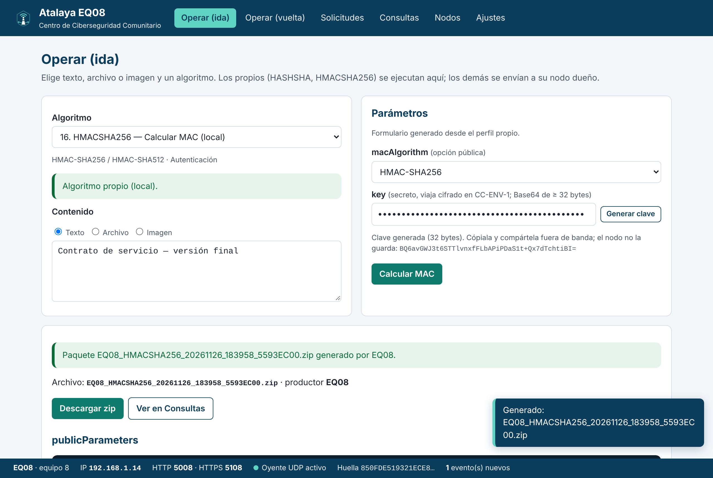

# Reporte general — Nodo EQ08 (Atalaya)

| Campo | Valor |
| --- | --- |
| Materia | Virología y Criptografía · UPIICSA · 2027-1 |
| Proyecto | Centro de Ciberseguridad Comunitario |
| Equipo | 8 (`EQ08`) <!-- TODO: integrantes --> |
| Docente | <!-- TODO: nombre del docente --> |
| Fecha de este reporte | 2026-11-26 (los resultados son del commit `b937017`) |
| Estado | Desarrollo completo. Faltan la prueba integrada con los demás equipos y la verificación en Windows y LAN reales |

> Las secciones marcadas con `<!-- TODO -->` debe completarlas el equipo: integrantes, resultados de la prueba integrada y conclusiones personales.

## 1. Objetivos

Construir el nodo `EQ08` del Centro de Ciberseguridad Comunitario conforme al [Estándar de Comunicación v2.0](../estandar/Estandar_Comunicacion_v2.0.md):

1. **Proveedor**: ejecutar `HASHSHA` (SHA-256/512) y `HMACSHA256` para cualquier nodo (`forward` / `inverse`).
2. **Solicitante**: operar con los 21 algoritmos desde la interfaz, delegando los 19 ajenos al equipo dueño.
3. **Emisor y receptor**: paquetes `.zip` v2.0 firmados con RSA-PSS, bandeja de Solicitudes y Consultas.
4. **Red**: anuncio UDP, escaneo de respaldo, alta manual y confianza por huella fijada (TOFU).
5. **Entregables del curso** ([requerimientos](../referencia/Requerimientos_proyecto.md)): arquitectura, BD con ≥ 30 registros, lenguaje de programación, API, servidor web, conectividad entre dispositivos y los 5 documentos.

| Entregable del curso | Dónde |
| --- | --- |
| Arquitectura de software | [Manual técnico](Manual_Tecnico.md) §1–2, [ADR](../arquitectura/decisiones/README.md) |
| Base de datos (≥ 30 registros) | [docs/base-de-datos](../base-de-datos/README.md): 9 tablas, semilla de 38 registros |
| Lenguaje de programación | C# 14 / .NET 10 LTS (Python solo para la verificación independiente) |
| APIs | [docs/api](../api/README.md) y [OpenAPI](../api/openapi.json) |
| Servidor web | ASP.NET Core Kestrel (HTTP 5008 / HTTPS 5108) + Blazor Server |
| Conectividad entre dispositivos | UDP 5099, escaneo, alta manual, HTTP(S) entre nodos ([Manual de instalación](Manual_Instalacion_Configuracion.md)) |
| Manual técnico · Backlog · Manual de instalación y configuración · Manual de identidad · Reporte general | [Técnico](Manual_Tecnico.md) · [Backlog](../backlog/Backlog.md) · [Instalación](Manual_Instalacion_Configuracion.md) · [Identidad](Manual_Identidad.md) · este documento |

## 2. Arquitectura (resumen)

Una sola aplicación ASP.NET Core hospeda la API, la interfaz Blazor y los servicios de descubrimiento. Está organizada en seis proyectos con dependencias en una sola dirección: `Web → Application → (Crypto, Packaging, Discovery, Infrastructure)`. Todo algoritmo, local o remoto, se usa con el contrato `forward` / `inverse`. El detalle, con diagramas, está en el [Manual técnico](Manual_Tecnico.md).



## 3. Metodología

- **9 fases** (plan §6), cada una como épica del [backlog](../backlog/Backlog.md), con un commit por historia (Conventional Commits) y un commit de cierre por fase.
- **Pruebas primero en lo normativo**: cada regla «DEBE» implementada tiene una prueba que cita la sección del estándar; cada código `E-...` que EQ08 devuelve tiene una prueba de API.
- **Verificación independiente**: una implementación en Python (`cryptography`) escrita a partir del estándar valida lo que produce .NET, y al revés.
- **CI** en GitHub Actions: compilación con advertencias como errores, pruebas en Ubuntu y Windows, y publicación autocontenida `win-x64` y `linux-x64`.

## 4. Resultados de pruebas

### 4.1 Ejecución local (Linux, .NET SDK 10.0.115, Python 3.13.18)

Salida real de la ejecución del 2026-11-26 (18:46 UTC):

```text
$ dotnet build CentroCiber.slnx -warnaserror
    0 Warning(s)
    0 Error(s)

$ dotnet test CentroCiber.slnx
Passed!  - Failed:     0, Passed:    48, Skipped:     0, Total:    48, Duration: 4 s - CentroCiber.Crypto.Tests.dll (net10.0)
Passed!  - Failed:     0, Passed:    54, Skipped:     0, Total:    54, Duration: 1 s - CentroCiber.Packaging.Tests.dll (net10.0)
Passed!  - Failed:     0, Passed:    20, Skipped:     0, Total:    20, Duration: 727 ms - CentroCiber.Web.Tests.dll (net10.0)
Passed!  - Failed:     0, Passed:    68, Skipped:     0, Total:    68, Duration: 14 s - CentroCiber.Api.Tests.dll (net10.0)

$ python3 -m pytest tests/interop -q
18 passed in 0.22s
```

**Total: 190 pruebas .NET y 18 pruebas Python, sin fallos ni pruebas omitidas.**

### 4.2 Qué demuestran

| Área | Pruebas destacadas | Resultado |
| --- | --- | --- |
| Vectores NIST FIPS 180-4 (SHA-256/512, incluido el millón de «a») y RFC 4231 casos 1–7 | `AlgorithmTests` | ✅ |
| Certificado §7, PFX con contraseña, RSA-PSS con sal de 32 bytes verificada sobre la estructura EM | `IdentityTests`, `SigningAndEnvelopeTests` | ✅ |
| Las 14 validaciones de §13.1, una prueba por código (zip-slip, zip-bomb, 4 archivos, timestamp viejo y futuro, `packetId` repetido…) | `PackageTests` (30+ casos) | ✅ |
| Los 8 pasos de §13.2 y cada código `E-...` por API | `ProviderApiTests`, `InboxApiTests`, `JobsApiTests` | ✅ |
| HTTPS con el certificado de identidad y cliente con huella fijada | `Https_uses_identity_certificate` | ✅ |
| Dos instancias se descubren por UDP, TOFU, alerta de cambio de huella, escaneo, alta manual, fuera de línea a 90 s | `DirectoryAndDiscoveryTests` | ✅ |
| Delegación AESGCM contra `MockNode` (EQ01 simulado), síncrona y con `202` + `jobId` | `DelegationTests` | ✅ |
| **Punta a punta entre dos nodos**: EQ08 `forward` → bandeja de EQ09 → Aceptar → EQ09 `inverse` delegado a EQ08 por HTTPS, para HASHSHA y HMACSHA256 | `EndToEndTests` | ✅ |
| Interoperabilidad .NET ↔ Python (firma, hash canónico, sobres, paquetes, vectores) | `InteropBridgeTests`, `tests/interop` | ✅ |
| Interfaz: formulario desde el perfil, bandeja, alerta de huella, barra de estado, notificaciones, filtro solo-LAN, las 6 pantallas | `CentroCiber.Web.Tests`, `UiHostTests` | ✅ |

### 4.3 Integración continua

El workflow `CI` (`.github/workflows/ci.yml`) terminó con éxito en **Ubuntu y Windows** en los cierres de las 9 fases. Esto incluye las pruebas de UDP, HTTPS, delegación y vectores en Windows. La ejecución del cierre de la fase 9 ([run 9](https://github.com/yaelrdf/Proyecto_Virologia_y_Criptografia_UPIICSA/actions/runs/45878770073)) publicó los artefactos autocontenidos `centrociber-eq08-win-x64` (≈ 54 MB) y `centrociber-eq08-linux-x64` (≈ 54 MB), además de los resultados de pruebas de ambos sistemas. <!-- TODO: confirmar el estado de la última ejecución antes de entregar -->

### 4.4 Recorridos manuales en el entorno de desarrollo

- Binario autocontenido `linux-x64` publicado y respondiendo `GET /api/status` en 5008.
- `scripts/run-two-nodes.sh`: EQ08 y EQ09 en una máquina, descubiertos por broadcast real en `255.255.255.255:5099`.
- Interfaz recorrida con un navegador Chromium automatizado: alta manual y confirmación de EQ01 simulado, HMAC local, AESGCM delegado, Operar (vuelta) con los 14 pasos y veredicto «válido», y descarga del original.
- Ejemplo `curl` de `docs/api/README.md` ejecutado: `200 application/zip`, y el paquete se verificó con Python.

## 5. Conformidad con el estándar

La lista de §16.2 con evidencia está en [Conformidad.md](../interoperabilidad/Conformidad.md). Resumen: los puntos 1, 3, 4, 6 y 7 están cumplidos con evidencia ejecutada. Los puntos 2, 8 y 9 se cumplen en el entorno local (dos instancias en una máquina, nodo simulado EQ01 y la implementación independiente en Python), pero falta confirmarlos en una LAN real con los equipos reales. El punto 5 (validar los vectores ajenos) depende de que los demás equipos los publiquen.

Interpretaciones del estándar tomadas por EQ08 y que el equipo debe aprobar: ADR [0005](../arquitectura/decisiones/0005-inverse-timestamp-replay.md) (en `inverse`, la ventana de tiempo y la anti-repetición se aplican a la petición), [0006](../arquitectura/decisiones/0006-unpinned-requester.md) (solicitante no fijado), [0007](../arquitectura/decisiones/0007-result-public-parameters.md) (`publicParameters` de `result`) y [0011](../arquitectura/decisiones/0011-job-result-access.md) (acceso a resultados y destino ajeno).

## 6. Matriz de interoperabilidad

La matriz actual está en [Matriz.md](../interoperabilidad/Matriz.md): las combinaciones automatizadas (EQ08 como proveedor, delegación al EQ01 simulado y punta a punta EQ08 ↔ EQ09) están en ✅; las de los equipos reales, pendientes.

<!-- TODO: después de la prueba integrada, copiar aquí la matriz final con fechas y resultados -->

## 7. Problemas encontrados y lecciones

| Problema | Causa | Solución / lección |
| --- | --- | --- |
| Invertir un paquete guardado más de 10 min antes daría `E-TIMESTAMP` si se aplicara §13.1 #13 literalmente | Ambigüedad del estándar en `inverse` | ADR 0005: ventana y anti-repetición sobre la petición. Lección: documentar las interpretaciones en lugar de suponer en silencio |
| El orden del sujeto X.509 salió invertido (`C=MX, …, CN=EQ08`) | `X500DistinguishedNameBuilder` agrega los RDN en orden de codificación | Se agregan en orden inverso; una prueba compara el sujeto exacto y Python verifica el RFC 4514 |
| Un paquete con datos muy compresibles podía superar la razón 100:1 y que otro nodo lo rechazara como zip-bomb | Compresión `deflate` del contenido | `datos.enc` y `resultado.enc` se guardan con `store` |
| MVC devolvía 415 sin cuerpo `problem+json` | El atributo `[Consumes]` responde antes del controlador | El middleware de la API convierte el 415 en `E-UNSUPPORTED-MEDIA` |
| Controladores no encontrados al arrancar el host desde las pruebas | MVC busca controladores en el ensamblado de entrada | `AddApplicationPart` explícito |
| La interfaz sin estilos al ejecutar el binario de `bin/` en Production | Los recursos web estáticos solo se mapean en Development o al publicar | `UseStaticWebAssets()` siempre |
| Los vectores podían cambiar de bytes en Windows | Conversión de finales de línea de git | `.gitattributes` marca `vectores/**` como binario |
| Clientes HTTP hacia nodos de la LAN pasaban por el proxy del sistema | `HttpClient` usa el proxy de las variables de entorno | `UseProxy = false` en los clientes hacia nodos |

<!-- TODO: lecciones del equipo (organización, coordinación con otros equipos, aprendizajes de criptografía) -->

## 7 bis. Versión 1.1.0: pruebas con otros equipos

- **Caso real con EQ01**: sus paquetes llegaban sin `requestId` ni `parts` y EQ08 los rechazaba con `E-MANIFEST`. Se corrigió (ADR 0014) y se agregó el diagnóstico de rechazos.
- **Contradicción §4.2/§9.6**: AAD = `packetId` contra un `packetId` nuevo al reenviar. Se resolvió conservando el `packetId` en AESGCM y CHACHA20 (ADR 0015).
- **Revisión de RelayCryptoNode (EQ06)**: solo lectura; su licencia es propietaria. Llevó a los ADR 0016 (solo campos firmados obligatorios) y 0017 (apertura tolerante de resultados). Ver [RelayCryptoNode.md](../interoperabilidad/RelayCryptoNode.md).
- **Panel de pruebas**: páginas Enviar y Bandeja, con vista previa segura.
- Los resultados de las pruebas de la versión 1.1.0 están en la descripción de la Release y en la CI (sección 4.3). <!-- TODO: copiar aquí el resumen de la ejecución de release.yml de v1.1.0 -->

## 8. Trabajo futuro

- Prueba integrada con todos los equipos y llenado de la matriz §16.3.
- Validar los vectores de los demás equipos en cuanto se publiquen.
- Proponer al coordinador del estándar las interpretaciones de los ADR 0005, 0006, 0007 y 0011 para la v2.1.
- Implementar opcionalmente un algoritmo reservado (por ejemplo, `DIGITALSIG`) siguiendo el Manual técnico §9.
- Guardar la llave privada en el almacén del sistema operativo (DPAPI en Windows, *keyring* en Linux), como recomienda §7.
- Persistir la cola de trabajos asíncronos para que sobreviva a reinicios.

## 9. Verificación manual pendiente

Ver la lista en el [Manual de instalación §10](Manual_Instalacion_Configuracion.md#10-verificación-manual-pendiente) y en el [backlog](../backlog/Backlog.md) (historias 🖐): instalación en Windows real, descubrimiento en una LAN real, recorrido entre dos laptops, delegación a cada equipo real e instalación por una persona ajena al equipo.

## 10. Conclusiones

<!-- TODO: conclusiones del equipo -->
