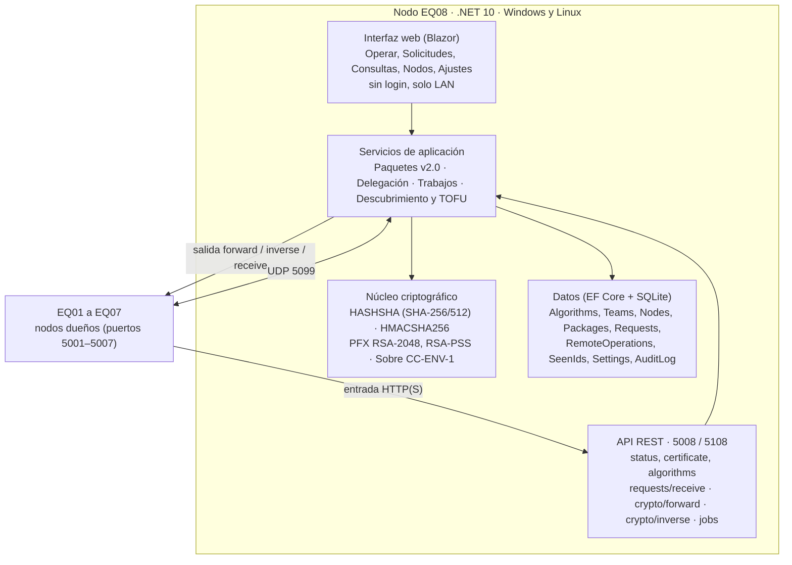

# Plan de implementación — Nodo EQ08 (Equipo 8) · Estándar v2.0

Versión del 26/11/2026. Fuente editable: documento compartido del equipo. Normativa: [`docs/estandar/Estandar_Comunicacion_v2.0.md`](../estandar/Estandar_Comunicacion_v2.0.md).

## 1. Resumen y objetivos

El Equipo 8 construirá el nodo `EQ08` en .NET 10 LTS (Blazor Server + SQLite) conforme al *Estándar de Comunicación v2.0*. El nodo ejecuta localmente `HASHSHA` (15) y `HMACSHA256` (16) y delega los otros 19 algoritmos al equipo dueño mediante `POST /api/crypto/forward` e `inverse`. Corre en Windows (demo) y Linux (desarrollo).

Objetivos:

1. **Proveedor:** atender `forward` (calcular hash / MAC) e `inverse` (verificar y devolver el original cifrado para el solicitante) de HASHSHA y HMACSHA256 para cualquier nodo.
2. **Solicitante:** desde la interfaz, operar con los 21 algoritmos; los ajenos se envían al nodo dueño según el diccionario 4.1.
3. **Emisor y receptor:** paquetes `.zip` v2.0 firmados, bandeja Solicitudes y Consultas.
4. **Red:** anuncio UDP, escaneo de respaldo, alta manual y confianza por huella fijada (TOFU).
5. **Entregables académicos:** arquitectura, BD con ≥ 30 registros, APIs, web server, conectividad entre dispositivos y los 5 documentos (manual técnico, backlog, manual de instalación y configuración, manual de identidad, reporte general).

Decisiones del Equipo 8:

| Tema | Decisión |
| --- | --- |
| Identidad | `nodeId` = `EQ08`, `teamNumber` = 8 |
| Puertos | HTTP `5008`, HTTPS `5108`, anuncio UDP `5099` |
| Stack | .NET 10 LTS (soporte hasta noviembre de 2028), ASP.NET Core + Blazor Server, EF Core 10 + SQLite. .NET 8 se descartó porque su soporte terminó el 10/11/2026 |
| Plataformas | Desarrollo en Linux; ejecución en Windows y Linux; publicación autocontenida `win-x64` y `linux-x64` |
| Variantes ofrecidas | `SHA-256`, `SHA-512`, `HMAC-SHA256` (no se anuncian `SHA3-256` ni `HMAC-SHA512`) |
| Clave HMAC | Botón “Generar clave” (32 bytes aleatorios) o pegar una en Base64 de ≥ 32 bytes; sin contraseñas |
| Certificado de identidad | RSA-2048 autofirmado, `CN=EQ08`, 365 días, guardado como `.pfx` con contraseña |
| Contraseña del PFX | Variable de entorno `CC_PFX_PASSWORD` (o *user-secrets* en desarrollo); nunca en el repositorio ni en la BD |
| Transporte | HTTP obligatorio + HTTPS con el mismo certificado; como cliente usa HTTPS si el otro nodo lo anuncia |
| Interfaz | Sin inicio de sesión; responde solo desde direcciones privadas de la LAN |
| Algoritmos reservados (17–21) | Ninguno; se muestran como “sin proveedor” |
| Coordinación | Solo publicar los vectores de prueba de EQ08 |
| Idioma | Documentación e interfaz en español; código, identificadores y commits en inglés |
| Licencia | GPL-3.0 (ya incluida en el repositorio) |

## 2. Alcance de algoritmos

EQ08 implementa 2 de los 21 códigos y consume los otros 19 como servicios remotos. Las primitivas comunes del estándar (SHA-256, RSA-PSS, sobre `CC-ENV-1`) se implementan aparte porque todo paquete las usa.

### 2.1 Algoritmos propios

| Código | `forward` | `inverse` | Secretos (`CC-ENV-1`) | `publicParameters` | `datos.enc` |
| --- | --- | --- | --- | --- | --- |
| `HASHSHA` (15) | Calcular hash con `SHA-256` o `SHA-512` | Recalcular, comparar y devolver el original + `verification.valid` | Ninguno | `hashAlgorithm`, `digestHex` | Archivo original |
| `HMACSHA256` (16) | Calcular `HMAC-SHA256` con la clave del solicitante | Recalcular con la clave recibida, comparar en tiempo constante y devolver el original + `verification.valid` | `key` (Base64, ≥ 32 bytes) | `macAlgorithm`, `macHex` | Archivo original |

Reglas propias que se derivan del estándar:

- La clave HMAC nunca se guarda: llega en el sobre, se usa y se borra de memoria.
- Un `verification.valid = false` se devuelve como `200` con el veredicto, no como error (`E-VERIFY-FAILED` no se usa por defecto).
- El resultado de `inverse` siempre va en `resultado.enc`, cifrado con `CC-ENV-1` para el certificado del solicitante.
- `GET /api/algorithms` publica el perfil de ambos algoritmos (variantes, entradas, secretos, opciones, `maxPayloadBytes` = 52 428 800).

### 2.2 Algoritmos delegados (diccionario 4.1)

| Nodo dueño | Algoritmos | Tipo de llave |
| --- | --- | --- |
| `EQ01` | `AESGCM`, `DES` | Secreta |
| `EQ02` | `TRIPLEDES`, `CHACHA20` | Secreta |
| `EQ03` | `RSA`, `ECC` | `keyId` |
| `EQ04` (por confirmar) | `DIFFIEHELLMAN`, `CAESAR` | `keyId` / secreta |
| `EQ05` | `VIGENERE`, `XORASM` | Secreta |
| `EQ06` | `LSBSTEGO`, `EUCLIDESAFFINE` | Secreta (LSBSTEGO pide además imagen portadora) |
| `EQ07` | `MILLERRABIN`, `FISHERYATES` | `keyId` / secreta |
| Sin dueño | `DIGITALSIG`, `QUANTUMPQC`, `DFTSPECTRAL`, `LAGRANGESHAMIR`, `LORENZSZ40` | Se usan solo si algún nodo los anuncia |

EQ08 no conoce la lógica de estos algoritmos: arma la petición, cifra los secretos para el dueño, envía y guarda el paquete que regresa. Para los de `keyId`, solo conserva el `keyRef` que viene en el manifiesto.

## 3. Arquitectura modular

EQ08 es una sola aplicación ASP.NET Core que hospeda la interfaz Blazor, la API REST y dos servicios en segundo plano (anuncio UDP y monitoreo de nodos). Todo algoritmo, propio o ajeno, se usa a través del mismo contrato `forward` / `inverse`.

Las peticiones de otros nodos entran por HTTP 5008 o HTTPS 5108; las delegaciones y los anuncios UDP salen desde los servicios.

### 3.1 Proyectos de la solución

| Proyecto | Responsabilidad |
| --- | --- |
| `CentroCiber.Web` | Host: páginas Blazor, controladores de la API, Kestrel en `0.0.0.0:5008` (HTTP) y `0.0.0.0:5108` (HTTPS con el PFX), filtro “solo LAN” para la interfaz |
| `CentroCiber.Application` | Casos de uso: operar (`forward`/`inverse`), enviar a bandeja, recibir, aceptar/rechazar, reenviar con re-firma, trabajos asíncronos |
| `CentroCiber.Crypto` | `HASHSHA`, `HMACSHA256`, identidad X.509 (generar/cargar PFX), firma RSA-PSS (sal 32, MGF1-SHA256), sobre `CC-ENV-1`, comparaciones en tiempo constante |
| `CentroCiber.Packaging` | Manifiesto v2.0, hash canónico de `publicParameters`, cadena de firma, nomenclatura `EQ08_...` / `RES_EQ08_...`, zip interno `multipart`, las 14 validaciones de recepción |
| `CentroCiber.Discovery` | Emisor y oyente UDP 5099 (cada 30 s, `offline` al apagar), escaneo /24 en 5001–5020, directorio y TOFU |
| `CentroCiber.Infrastructure` | EF Core + SQLite, cliente HTTP hacia otros nodos (HTTPS con fijación de huella), almacenamiento de zips en disco |
| `CentroCiber.Tests` | xUnit: vectores NIST y RFC 4231, vectores de otros equipos, pruebas de cada código de error, nodo simulado |

### 3.2 Contrato común de algoritmos

- `IAlgorithmProvider` expone `ForwardAsync` e `InverseAsync` y devuelve siempre un paquete `package` o `result` v2.0.
- **Proveedor local** para `HASHSHA` y `HMACSHA256`.
- **Proveedor remoto** para el resto: elige el nodo dueño (tabla 4.1; para reservados, el `teamNumber` menor que los anuncie), firma la petición, cifra secretos para el dueño y maneja la respuesta `200` o `202` + consulta de `jobId`.
- Las operaciones propias son de milisegundos para 50 MB, pero el servidor implementa igual la cola de trabajos (tope 30 s, retención 1 h) para cumplir el estándar.

### 3.3 Base de datos (SQLite)

| Tabla | Contenido | Registros semilla |
| --- | --- | --- |
| `Algorithms` | Diccionario 4.1: id, código, categoría, equipo dueño, nombres de `forward`/`inverse`, tipo de llave | 21 |
| `Teams` | Número de equipo, `nodeId`, puertos HTTP/HTTPS calculados | 8 |
| `Nodes` | Directorio 6.4: IP, puertos, huella fijada, algoritmos anunciados, origen, estado, última vez visto | 1 (EQ08) |
| `Packages` | Consultas: zip, origen `Generado`/`Recibido`/`Resultado`, algoritmo, operación, `producerNode`, hashes, `keyRef`, ruta en disco | 4 de ejemplo |
| `Requests` | Solicitudes: IP, remitente, resultado de validación, estado `Pendiente`/`Aceptada`/`Rechazada` | 3 de ejemplo |
| `RemoteOperations` | Peticiones enviadas y recibidas: `requestId`, `jobId`, estado, nodo | — |
| `SeenIds` | `packetId` y `requestId` ya vistos (anti-repetición) | — |
| `Settings` | Variantes habilitadas, HTTPS activo, ruta del PFX, límites | 1 |
| `AuditLog` | Envíos, recepciones, validaciones y códigos `E-...`, sin secretos | crece con el uso |

La semilla suma 38 registros (mínimo requerido: 30). Los zips viven en disco; la BD guarda ruta y hashes.

## 4. Cumplimiento del estándar v2.0

EQ08 implementa el estándar completo, sin extensiones propias.

| Sección del estándar | Qué implementa EQ08 | Componente |
| --- | --- | --- |
| 3. Identificadores | Validadores por expresión regular para `nodeId`, UUID, `keyId`, `timestampUtc`, huellas y hashes | `Packaging` |
| 4. Diccionario | Semilla de `Algorithms` y `Teams`; perfil propio en `GET /api/algorithms`; lectura de perfiles ajenos | `Application`, `Web` |
| 5. Red | HTTP 5008, HTTPS 5108, `0.0.0.0`; scripts de firewall para Windows (`netsh`) y Linux (`ufw`) | `Web`, instalación |
| 6. Descubrimiento | Anuncio UDP 5099 cada 30 s, oyente, escaneo /24, alta manual, TOFU y alerta por cambio de huella | `Discovery` |
| 7. Certificado | RSA-2048, `CN=EQ08, OU=Equipo 08, O=Centro de Ciberseguridad, C=MX`, 365 días, serie aleatoria de 64 bits, PFX | `Crypto` |
| 8. Primitivas | RSA-PSS-SHA256, `CC-ENV-1`, cadena de firma, hash canónico de parámetros | `Crypto`, `Packaging` |
| 9. Paquete | Tipos `package` y `result`, nomenclatura, 3 archivos, `multipart`, reenvío con re-firma | `Packaging` |
| 10. API | Los 9 endpoints, encabezados `X-CC-*`, límite 50 MB | `Web` |
| 11. Flujos | Operación local, delegación `forward`/`inverse`, envío a bandeja, dueño fuera de línea | `Application` |
| 12. `keyId` | Solo como cliente: conserva y reenvía `keyRef`; no guarda llaves ajenas | `Application` |
| 13. Validaciones | Las 14 validaciones de recepción y las 8 de petición, en orden | `Packaging`, `Web` |
| 14. Errores | `application/problem+json` con los 29 códigos del Anexo B | `Web` |
| 15. Bandeja | Solicitudes con “Remitente no confirmado”; Consultas con tres orígenes | `Web` |
| 16. Conformidad | Vectores `vectores/EQ08/` y lista 16.2 | `Tests` |

### 4.1 Endpoints de EQ08

| Método y ruta | Qué responde EQ08 |
| --- | --- |
| `GET /api/status` | `nodeId` `EQ08`, `teamNumber` 8, `httpPort` 5008, `httpsPort` 5108, algoritmos 15 y 16, huella, hora del servidor |
| `GET /api/certificate` | PEM del certificado de identidad |
| `GET /api/algorithms` | Perfiles de `HASHSHA` y `HMACSHA256` |
| `POST /api/requests/receive` | `202` y registro `Pendiente`, o el error de la validación que falló |
| `POST /api/crypto/forward` | `200` con `EQ08_<ALG>_..._.zip`; `404 E-ALGORITHM-NOT-PROVIDED` para códigos ajenos |
| `POST /api/crypto/inverse` | `200` con `RES_EQ08_<ALG>_..._.zip` y `verification` |
| `GET /api/jobs/{jobId}` y `/result` | Estado y resultado; solo para el `requesterNode` original |
| `GET /api/keys/{keyId}` | No se implementa (EQ08 no tiene algoritmos con `keyId`) |

### 4.2 Ejemplo de flujo típico (EQ03 verifica un HMAC con EQ08)

1. EQ03 cifra la clave HMAC en `CC-ENV-1` para la huella de EQ08.
2. Envía `POST /api/crypto/inverse` con `request`, `requestSignature`, `requesterCertificate` y `package`.
3. EQ08 valida petición y paquete, abre el sobre, recalcula el HMAC y compara.
4. Cifra el original para EQ03 y responde `200` con el `result` firmado y `verification.valid`.
5. EQ08 descarta la clave y registra el evento en `AuditLog` sin datos secretos.

## 5. Interfaz web

La interfaz Blazor tiene 6 pantallas en español, sin inicio de sesión y accesible solo desde direcciones privadas de la LAN (10/8, 172.16/12, 192.168/16 y localhost). Los formularios de cada algoritmo se construyen con el perfil que publica su dueño en `GET /api/algorithms`.

| Pantalla | Qué hace | Elementos clave |
| --- | --- | --- |
| Operar (ida) | Elegir texto, archivo o imagen, algoritmo (21 códigos) y ejecutar `forward` local o en el nodo dueño | Selector con nombre de la operación (“Cifrar”, “Calcular hash”, “Ocultar”…), estado del dueño, formulario por perfil, campo de imagen portadora para LSBSTEGO, botón “Generar clave” para HMAC |
| Operar (vuelta) | Subir un `.zip` o tomarlo de Consultas y ejecutar `inverse` | Validación paso a paso (14 pasos), captura de secretos, veredicto `valid` para hash/MAC/firma, descarga del original |
| Solicitudes | Bandeja de paquetes recibidos | Remitente, IP, zip, algoritmo, operación, `Firma OK` / `Inválida` / `Remitente no confirmado`, Aceptar y Rechazar |
| Consultas | Historial de paquetes | Filtro por origen `Generado` / `Recibido` / `Resultado`, ver manifiesto, descargar, ejecutar `inverse`, reenviar con re-firma |
| Nodos | Directorio | Lista con estado y algoritmos, “Buscar nodos” (escaneo), alta manual, confirmar huella (TOFU), alerta roja si la huella cambia |
| Ajustes | Configuración del nodo | Variantes habilitadas, HTTPS activo, regenerar certificado (con aviso de que cambia la huella), límites, ruta del PFX |

Una barra de estado fija muestra `EQ08`, la IP local, los puertos 5008/5108 y si el oyente UDP está activo. Las nuevas solicitudes y los trabajos asíncronos terminados llegan en tiempo real por el circuito SignalR de Blazor.

## 6. Fases, entregables y pruebas

El trabajo avanza en 9 fases; cada una cierra con un criterio verificable. Todas se desarrollan en Linux y se prueban también en Windows.

1. **Base multiplataforma.** Solución .NET 10 con los 7 proyectos, EF Core + SQLite, migraciones, semilla de 38 registros, publicación autocontenida `win-x64` y `linux-x64`.
    - Criterio: el mismo código publica para Windows y Linux y responde `GET /api/status` en 5008.
2. **Identidad y primitivas.** Generar o cargar el PFX (`CC_PFX_PASSWORD`), certificado según sección 7, RSA-PSS, `CC-ENV-1`, hash canónico, cadena de firma.
    - Criterio: pruebas con los ejemplos del Anexo A del estándar; un sobre creado en EQ08 se abre en una prueba con otra librería (Python `cryptography` u OpenSSL).
3. **Algoritmos propios.** `HASHSHA` (SHA-256, SHA-512) y `HMACSHA256`.
    - Criterio: vectores NIST (SHA-2) y RFC 4231 (HMAC) pasan; la comparación es en tiempo constante.
4. **Paquetes v2.0.** Constructor y validador `package`/`result`, nomenclatura, `multipart`, reenvío con re-firma, las 14 validaciones.
    - Criterio: una prueba por cada código de error de 13.1, incluidos zip con 4 archivos, zip-slip, zip-bomb, timestamp viejo y `packetId` repetido.
5. **API de proveedor.** Los 9 endpoints, encabezados `X-CC-*`, `problem+json`, cola de trabajos, HTTPS en 5108.
    - Criterio: `forward` e `inverse` de ambos algoritmos funcionan desde un cliente de prueba por HTTP y HTTPS.
6. **Descubrimiento y directorio.** Anuncio y oyente UDP, escaneo /24, alta manual, TOFU, estado `offline` a los 90 s.
    - Criterio: dos instancias (5008 y una simulada en otro puerto) se encuentran solas en Windows y en Linux.
7. **Cliente de delegación.** Petición firmada, sobre para el dueño, manejo de `200`/`202`/errores, consulta de `jobId`, `keyRef`.
    - Criterio: con un nodo simulado que imita a EQ01 se completa `forward` + `inverse` de AESGCM; después, al menos un algoritmo real de cada equipo.
8. **Interfaz web.** Las 6 pantallas, filtro solo-LAN, notificaciones en tiempo real.
    - Criterio: recorrido Operar → enviar a bandeja → Aceptar → Consultas → `inverse` entre una laptop Windows y una Linux.
9. **Conformidad y documentación.** Publicar `vectores/EQ08/` (certificado y llave de prueba, cadena de firma, parámetros canónicos, ejemplo por algoritmo), completar la lista 16.2 y los 5 manuales.
    - Criterio: otro equipo valida nuestros vectores; una persona ajena instala el nodo con el manual en Windows y en Linux.

**Backlog:** cada fase es una épica; cada criterio, una historia con su prueba de aceptación y la sección del estándar v2.0 que aplica.

**Matriz de interoperabilidad:** EQ08 registra cada combinación probada (nodo × algoritmo × operación) con fecha y resultado, como pide la sección 16.3; es evidencia para el reporte general.

## 7. Riesgos, supuestos y preguntas abiertas

| Riesgo | Impacto | Mitigación |
| --- | --- | --- |
| Otros equipos tardan en implementar v2.0 o lo interpretan distinto | Algoritmos ajenos fallan con `E-SIGNATURE` o `E-PARAMS-HASH` | Validar sus vectores 16.1 en cuanto los publiquen; nodo simulado para avanzar sin ellos |
| Equipo 4 sin confirmar | `DIFFIEHELLMAN` y `CAESAR` sin dueño real | El directorio usa lo que anuncie la red, no solo la tabla fija |
| La red escolar bloquea broadcast o aísla clientes | No hay descubrimiento ni tráfico entre nodos | Escaneo y alta manual; llevar router o hotspot propio a la demo |
| Diferencias Windows/Linux | Broadcast UDP, rutas de archivo y firewall se comportan distinto | Pruebas en ambos sistemas en cada fase; scripts `netsh` y `ufw`; `Path.Combine` siempre |
| Contraseña del PFX expuesta | Suplantación de EQ08 | Variable de entorno o *user-secrets*; `.pfx` y secretos en `.gitignore`; regenerar si se filtra |
| Relojes desfasados más de 10 min | `E-TIMESTAMP` en paquetes válidos | NTP activo en las máquinas de la demo; la UI muestra la diferencia con `serverTimeUtc` del otro nodo |
| Nombres de parámetros ajenos cambian | Formularios incorrectos | Los formularios se generan del perfil `GET /api/algorithms`, no de código fijo |

**Supuestos:** todos los nodos en la misma LAN; un nodo por equipo; las claves de algoritmos simétricos ajenos se comparten entre usuarios fuera de banda y se capturan al ejecutar `inverse`.

**Preguntas abiertas (dependen de los demás equipos):**

- [ ] ¿Confirma el Equipo 4 que le corresponden `DIFFIEHELLMAN` y `CAESAR`?
- [ ] ¿Cuándo publica cada equipo su perfil `/api/algorithms` y sus vectores de prueba?
- [ ] ¿Quién coordina el estándar, dónde estará el repositorio compartido y cuál es la fecha de congelamiento?
- [ ] ¿Qué red se usará en la prueba integrada y en la demo?
- [ ] ¿Los 30 registros pueden ser semilla de prueba, o deben provenir de intercambios reales con otros equipos?
